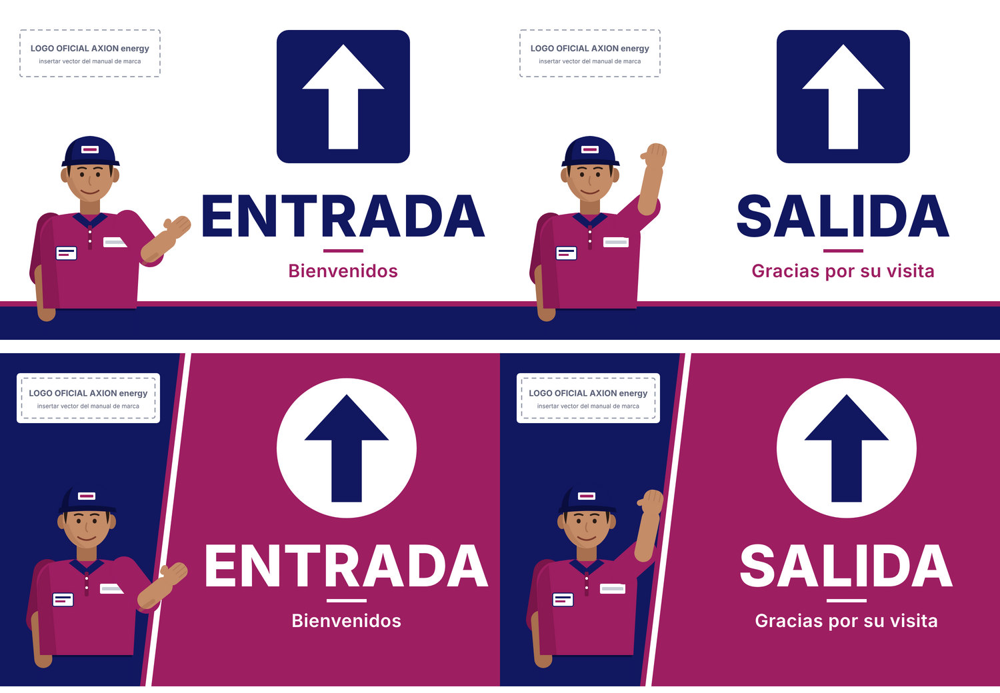
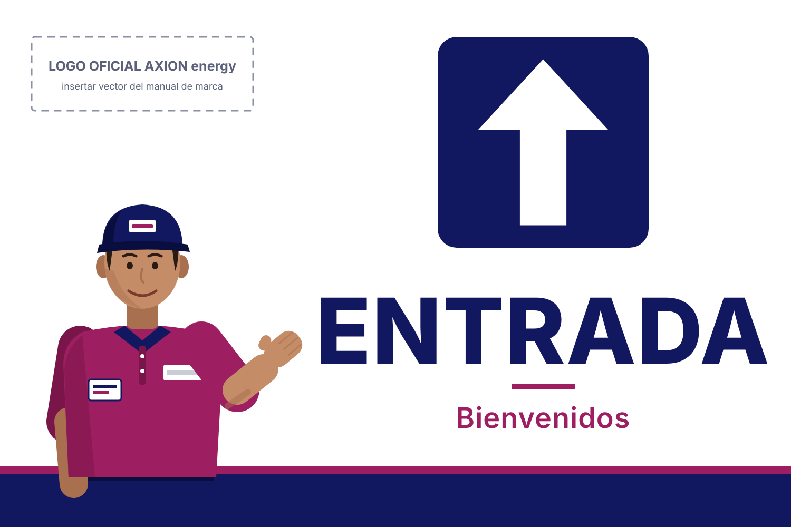
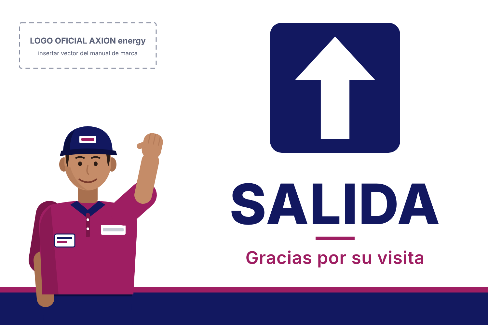
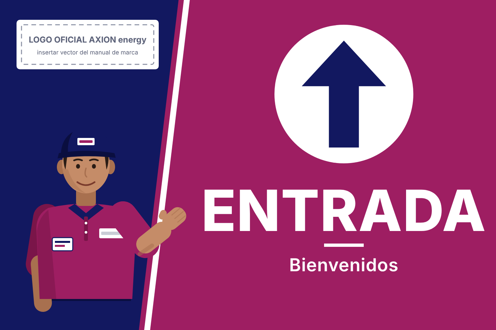
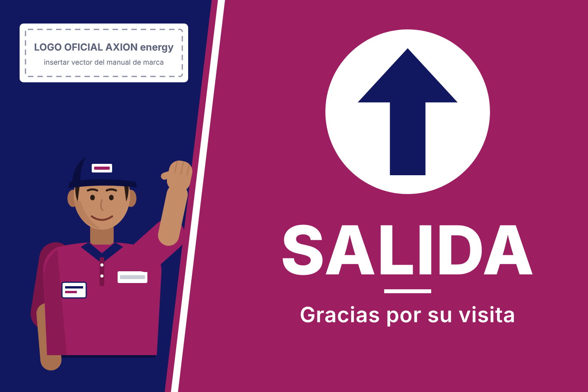
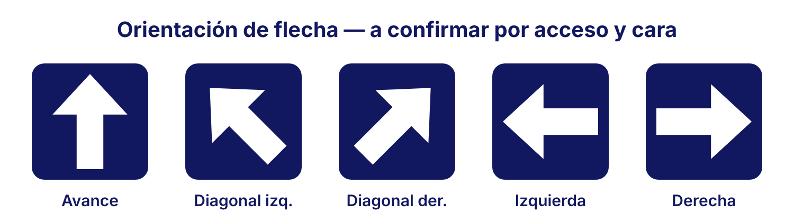
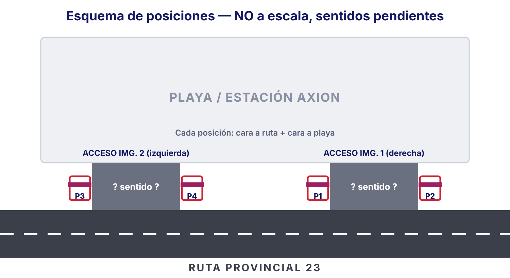

# Señalética de accesos · AXION Energy San Guillermo (RP 23)

**Etapa 1: propuestas creativas.** No son archivos para imprenta.

| Archivo | Contenido |
|---|---|
| `svg/A-minimalista-entrada.svg` / `-salida.svg` | Propuesta A, editable (1 unidad = 1 mm, panel de referencia de 1500 × 1000 mm) |
| `svg/B-impacto-entrada.svg` / `-salida.svg` | Propuesta B, editable |
| `svg/opciones-flecha.svg` | Orientaciones de flecha para validar en el lugar |
| `svg/esquema-posiciones.svg` | Esquema de las 4 posiciones y 8 caras (no está a escala) |
| `vistas/*.png` | Vistas previas |
| `generar.py` | Regenera todos los SVG. Los colores, textos y orientaciones de flecha están arriba, como constantes |

Cada SVG tiene capas con nombre (`fondo`, `logo-axion-reserva`, `placa-flecha`, `flecha`, `indicacion`, `mensaje-secundario`, `playero-*` y `guias-margen-seguridad`, que está oculta) para editarlas en Illustrator, Inkscape o Figma.

---

## 1. Análisis de la estación y los accesos

**Confirmado (por tu descripción):**
- Hay dos accesos desde la RP 23. En las fotos de referencia, la imagen 1 es el acceso de la derecha y la imagen 2 el de la izquierda.
- Cada acceso tiene estructuras laterales de hormigón blanco con barandas rojas y carteles chicos de circulación.
- La propuesta es poner dos carteles por acceso, uno a cada lado (4 soportes en total). Cada soporte puede tener cara hacia la ruta y cara hacia la playa.

**Pendiente:**
- **Las dos fotografías no llegaron a esta sesión.** El repositorio solo tenía `public/images/.gitkeep`. Por eso no pude analizar la arquitectura ni confirmar los sentidos. Las flechas de los bocetos apuntan hacia arriba (“avance”) solo como valor provisorio.
- Qué acceso es ENTRADA y cuál es SALIDA, y si alguno es de doble sentido.
- El sentido de circulación de la ruta frente a la estación y desde dónde se ve primero cada cartel.

**Lógica de caras propuesta (a validar):**

| Acceso | Cara hacia la ruta | Cara hacia la playa |
|---|---|---|
| Acceso de ENTRADA | **ENTRADA** + flecha | Solo marca, o nada. Si hace falta prohibir el paso, usar la señal reglamentaria |
| Acceso de SALIDA | “NO ENTRAR”: solo con la **señal reglamentaria vial**, sin la gráfica de marca | **SALIDA** + flecha |

> No se reemplaza ninguna señal reglamentaria. La familia AXION es complementaria.

## 2. Propuestas estéticas

**A · Institucional minimalista.** Fondo blanco con el azul AXION como color dominante. La flecha va en blanco sobre una placa azul y el magenta queda como acento (filete, mensaje secundario y banda inferior). Es la opción más sobria, la que mejor convive con el hormigón blanco y la de mejor lectura nocturna si se usa vinilo reflectivo blanco.

**B · Mayor impacto.** Fondo magenta con una cuña azul diagonal que aloja al playero y un filete blanco que separa las dos zonas. La flecha va en azul sobre un círculo blanco. Se reconoce como AXION a más distancia. El magenta oscuro rinde menos de noche, así que necesita iluminación o reflectivo en la flecha y el texto.

En ambas propuestas se mantiene el mismo orden de lectura: **flecha → indicación → marca**. La tipografía de referencia es Helvetica Neue Bold; en las vistas se usa Inter como sustituto. No se usó naranja, degradados ni efectos 3D.

**Logo:** no se dibujó ni se imitó el logotipo. En su lugar hay una reserva marcada donde va el **vector oficial del manual de marca AXION**: la versión a color en la propuesta A y sobre una placa blanca en la B.

## 3. Bocetos

| | ENTRADA | SALIDA |
|---|---|---|
| A |  |  |
| B |  |  |

## 4. El playero

- Ocupa el sector inferior izquierdo, a medio cuerpo, cortado por el borde inferior. Sube hasta la mitad del lateral izquierdo y no invade la columna de flecha y texto.
- Es una **ilustración vectorial original** (no es una persona real) con chomba magenta, pantalón y gorra azules, y credencial. Los rectángulos blancos de la gorra y el pecho son reservas para el bordado del logo oficial.
- **ENTRADA:** tiene el brazo abierto y presenta el mensaje (bienvenida). **SALIDA:** tiene la mano en alto (despedida).
- Para la etapa siguiente recomiendo mantener el estilo ilustrado semirrealista en lugar de una foto. Envejece mejor, no depende del permiso de un empleado, se imprime limpio en gran formato y no compite con la flecha. Falta refinar manos, rostro y volumen con una ilustración más trabajada.
- En la propuesta B, el magenta de la chomba se apoyaría sobre el fondo magenta. Por eso el playero va sobre la cuña azul.

## 5. Composición, legibilidad y soportes

- **Jerarquía:** la flecha ocupa unos 400 mm. ENTRADA y SALIDA tienen unos 125 mm de altura de mayúscula en un panel de 1500 mm, legibles a unos 50–60 m. Hay que reescalar según la distancia real de lectura y la velocidad de llegada.
- **Márgenes de seguridad:** 50 mm en la capa `guias-margen-seguridad`. Hay que sumar el sangrado y la zona de fijación cuando se conozca el soporte.
- **Contraste:** blanco sobre azul y azul sobre blanco tienen el máximo contraste. Hay que evitar textos magenta sobre azul.
- **Noche:** flecha y texto en **vinilo reflectivo grado ingeniería o alta intensidad** (blanco). El resto puede ir en vinilo de color con laminado UV mate, que no genera reflejos de faros.
- **Sustrato:** ACM (aluminio compuesto) de 3–4 mm o chapa de aluminio pintada, con bastidor de caño. Si va a doble faz, usar dos paneles espalda con espalda.
- **Montaje:** hay que respetar el hormigón y las barandas existentes, con fijación sobre parantes propios o anclaje químico. No debe tapar la visual de los conductores al salir.
- **Color:** los HEX son referencias. Para producir hay que pedir los Pantone/RAL y los vinilos homologados del manual AXION o del operador de la red.

## 6. Datos pendientes antes de producir

1. **Las dos fotografías**, más una foto frontal de cada estructura, con medidas.
2. Qué acceso es ENTRADA y cuál SALIDA, si hay doble sentido y el sentido de circulación de la RP 23 frente a la estación.
3. Las dimensiones disponibles en cada una de las 4 posiciones: ancho, alto, altura sobre el suelo y si es simple o doble faz.
4. La distancia y la velocidad de aproximación, para fijar el tamaño de letra y flecha.
5. Si hay iluminación nocturna en los accesos.
6. El **logo oficial vectorial** y las pautas de cartelería del operador AXION, y si la red debe aprobar piezas propias.
7. Las señales reglamentarias que deben quedar (y la normativa municipal o de Vialidad Provincial sobre cartelería junto a la ruta).
8. Qué propuesta preferís (A, B o una mezcla) y qué ajustes querés en el playero.
